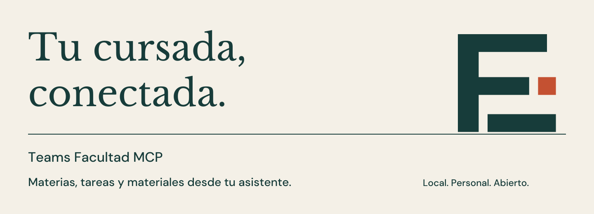

<p align="center">
  
</p>

# Teams Facultad MCP

[](https://github.com/Matias-Sanmiguel/teams-facultad-mcp/actions/workflows/tests.yml)
[](https://www.python.org/downloads/)
[](https://modelcontextprotocol.io/)
[](LICENSE)

Consultá **materias, tareas, consignas, anuncios y documentos de Teams Educación**
desde tu asistente de IA. Corre en tu computadora, con tu cuenta de la facu y un
navegador dedicado.

**Sin registrar una app en Entra ni solicitar permisos de Microsoft Graph.**
Lee la interfaz web que tu cuenta ya puede usar. Las políticas de tu institución
siguen vigentes: esto no permite saltarse una restricción de acceso.

[Instalar con mi agente de IA](INSTALL_WITH_AI.md) · [Instalación manual](#instalación-manual) · [Guía de uso](docs/GUIA.md) · [Reportar un problema](https://github.com/Matias-Sanmiguel/teams-facultad-mcp/issues)

## Pedile cosas de tu cursada

> “Listá mis tareas próximas y leé las consignas de las que vencen primero”.
>
> “Mostrame los últimos anuncios de una materia”.
>
> “Buscá el cronograma en los materiales del curso y resumilo”.

Cada compañero instala su copia e inicia sesión con su propia cuenta. El proyecto
es **gratuito y de código abierto**; el cliente o proveedor de IA que elijas puede
tener su propio costo.

## Instalá con tu agente de IA

Pegá esto en un agente con acceso a la terminal de tu computadora:

```text
Instalá y conectá el MCP local de este repositorio:
https://github.com/Matias-Sanmiguel/teams-facultad-mcp
Leé INSTALL_WITH_AI.md y seguí su prompt de instalación completo.
USE AT YOUR OWN RISK: acepto usar este proyecto bajo mi propia responsabilidad.
Prepará el entorno, ejecutá el instalador y configurá mi cliente MCP.
Yo voy a completar el inicio de sesión y MFA en el navegador dedicado.
Verificá el resultado y avisame si el cliente necesita reiniciarse.
```

El [prompt completo](INSTALL_WITH_AI.md) incluye instalación por sistema,
conservación de la configuración existente y comprobación de la conexión.

## Instalación manual

Necesitás **Python 3.11+**, un cliente que ejecute servidores MCP locales por
**stdio**, conexión a Internet y una sesión gráfica para iniciar sesión.
Se incluyen instaladores para **Windows, macOS y Linux**.

### 1. Descargá e instalá

[Descargá el ZIP de la última versión](https://github.com/Matias-Sanmiguel/teams-facultad-mcp/releases/latest)
y extraelo en una carpeta permanente. También podés clonar:

```sh
git clone https://github.com/Matias-Sanmiguel/teams-facultad-mcp.git
cd teams-facultad-mcp
```

**Windows — PowerShell**

```powershell
py -3 scripts/install.py
```

**macOS / Linux**

```sh
sh install.sh
```

El instalador crea `.venv`, instala dependencias fijadas con hashes, descarga
Chromium y genera `mcp-config.json`. No instala paquetes Python globales.
En Linux, Playwright puede informar que faltan bibliotecas del sistema;
seguí su diagnóstico y la [guía de dependencias](https://playwright.dev/python/docs/browsers#install-system-dependencies).

### 2. Iniciá sesión con tu cuenta

**Windows — PowerShell**

```powershell
& .\.venv\Scripts\python.exe -m teams_facultad_mcp login
```

**macOS / Linux**

```sh
.venv/bin/python -m teams_facultad_mcp login
```

Ingresá tu cuenta de la facu y completá MFA en la ventana que se abre. Cuando
Teams termine de cargar, el comando confirma la sesión y cierra el navegador.

### 3. Conectá tu cliente MCP

Copiá la entrada `teams-facultad` del archivo **`mcp-config.json`** a la configuración
de tu cliente. El archivo contiene las rutas y variables de esta computadora.
Conservá las demás entradas. Reiniciá o recargá los servidores del cliente.

```json
{
  "mcpServers": {
    "teams-facultad": {
      "command": "RUTA_ABSOLUTA/.venv/bin/python",
      "args": ["-m", "teams_facultad_mcp", "serve"],
      "env": {"TEAMS_MCP_HEADLESS": "1"}
    }
  }
}
```

En Windows, `command` termina en `.venv\\Scripts\\python.exe`. Algunos clientes
usan TOML u otro formato: conservá `command`, `args` y `env` del archivo generado.
En Linux, `env` puede incluir las variables necesarias para abrir la ventana.
Si tu cliente admite tiempos máximos, usá **30 s para iniciar** y **180 s por llamada**.
La [guía](docs/GUIA.md#conectar-tu-asistente) amplía estos pasos.

### Consultas sin ventana

La configuración generada desde la versión de `main` activa
**`TEAMS_MCP_HEADLESS=1`**: el MCP consulta Teams en segundo plano usando la sesión
guardada. Si usás el ZIP v0.1.0 o una instalación anterior, agregá esa variable
dentro de `env` y recargá tu cliente MCP.

La ventana se usa para el ingreso inicial y MFA mediante el comando `login`.
Si Microsoft vuelve a pedir acceso, cerrá el cliente MCP para liberar el perfil,
ejecutá el mismo comando `login` del paso 2 en una terminal gráfica y reabrí el
cliente. Configurá la variable solo en el cliente MCP; la terminal de ingreso
necesita el modo visible. Para diagnosticar con una ventana, usá
`TEAMS_MCP_HEADLESS=0` en la configuración del servidor.

## Ocho herramientas, una sesión local

| Herramienta | Qué podés consultar |
|---|---|
| `estado_conexion` | Estado del navegador y del ingreso |
| `iniciar_sesion` | Abrir el navegador para completar el ingreso |
| `listar_materias` | Equipos visibles y sus identificadores |
| `listar_tareas` | Próximas, vencidas o completadas; filtro por materia |
| `leer_tarea` | Consigna, fecha completa, estado y referencias |
| `leer_anuncios` | Publicaciones y respuestas visibles del canal General |
| `listar_archivos` | Archivos y carpetas del canal General |
| `leer_documento` | Texto de DOCX, PPTX y PDF, por fragmentos |

Las listas pueden ser parciales por la virtualización de Teams. El MCP devuelve
`completo`, `aviso` y cursores para que el asistente lo informe. Las fechas se
conservan como aparecen en Teams. Los documentos admiten hasta **25 MiB**;
no hay OCR ni extracción de imágenes o diagramas.

## Tu cuenta queda en tu computadora

El perfil de Chromium se guarda fuera del repositorio, en el directorio de datos
de tu usuario. No se usa el perfil de tu navegador habitual. El servidor no aloja
tu sesión ni manda documentos a un servicio propio. Los resultados consultados
pueden llegar al proveedor de IA de tu cliente, según su configuración.

**No compartas el perfil del navegador ni `mcp-config.json`.** Cada persona debe
instalar e iniciar sesión por su cuenta. Microsoft puede pedirte volver a entrar.

Las herramientas consultan contenido: no envían mensajes, entregan trabajos ni
editan documentos. Abrir anuncios puede marcarlos como leídos y Teams puede
actualizar tu presencia. Una actualización de su interfaz puede requerir ajustes
al conector. [Más sobre alcance y datos locales](docs/GUIA.md#alcance-y-límites).

## USE AT YOUR OWN RISK

**Usá este proyecto bajo tu propia responsabilidad.** Se ofrece “tal cual”, sin
garantías de disponibilidad, exactitud, integridad ni compatibilidad futura.
Verificá fechas, consignas y entregas directamente en Teams. Sos responsable del
uso de tu cuenta, de los datos que compartís con tu asistente y de respetar las
normas de tu institución. Los autores no asumen responsabilidad por daños o
pérdidas derivados del uso, en la medida permitida por la ley. Se aplican los
términos y la exclusión de garantías de la [licencia MIT](LICENSE).

Proyecto independiente, sin afiliación con Microsoft ni con ninguna universidad.
Los nombres de productos pertenecen a sus respectivos titulares.

## Desarrollo y contribuciones

```sh
.venv/bin/python -m pip install --require-hashes -r requirements-dev.lock
.venv/bin/python -m pytest -q
.venv/bin/python -m build
.venv/bin/python scripts/package.py
```

Las pruebas usan Chromium real con páginas sintéticas, sin una cuenta de la facu.
La matriz de CI cubre Linux, Windows y macOS; las pruebas con una cuenta real se
realizaron en Linux. [Qué verificamos y qué falta](docs/VERIFICACION.md).

Para contribuir, abrí un issue o un PR con la reproducción, la versión del sistema
y el resultado de `doctor` **sin datos privados**. No adjuntes cookies, capturas de
clases, URLs de autenticación ni documentos personales.

[Arquitectura](docs/ARQUITECTURA.md) · [Guía visual](DESIGN.md) · [Assets de marca](assets/branding/README.md) · [MIT](LICENSE)
