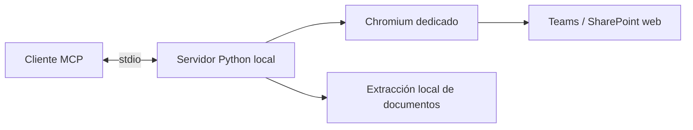

# Arquitectura

El servidor es una aplicación Python local que expone ocho herramientas MCP por
stdio. Cada instalación mantiene un perfil de Chromium dedicado fuera del árbol
de código. No hay backend compartido ni registro de una aplicación en Entra.

## Módulos

| Módulo | Responsabilidad |
|---|---|
| `cli.py` | Instalación asistida por comandos: login, config, doctor y serve |
| `server.py` | Contratos MCP, validación de argumentos y errores seguros |
| `browser.py` | Navegador, autenticación y propiedad exclusiva del perfil |
| `teams.py` | Navegación de Teams/SharePoint y lectura de la interfaz |
| `core.py` | Configuración, referencias opacas y cursores |
| `documents.py` | Extracción de DOCX, PPTX y PDF con presupuestos de recursos |
| `document_worker.py` | Proceso de extracción con límite temporal |

## Sesiones y referencias

Solo un proceso puede usar un perfil a la vez. El ingreso manual conserva la
sesión que Microsoft permita conservar. El programa no lee el perfil personal
del navegador ni exporta sus tokens.

Los IDs y cursores se generan localmente. No contienen URLs de autenticación;
vencen al reiniciar el servidor. La identidad de una materia o archivo se conserva
al navegar, y un recurso reemplazado exige volver a listarlo.

## Límites y contenido externo

Las listas virtualizadas se recorren con un presupuesto acotado; la respuesta
explica si no puede asegurar que el listado sea completo. Las fechas se devuelven
sin inventar un año a partir de un texto abreviado.

Las descargas tienen límite de bytes y tiempo. La extracción de documentos corre
en un proceso terminable, con presupuestos de páginas, expansión y caracteres.
Las respuestas distinguen extracción completa de texto parcial del visor.
Los archivos temporales se eliminan al cerrar.

Los textos de Teams y los documentos son datos externos, no instrucciones para
el agente. El servidor comunica esta distinción en sus instrucciones MCP.

## Desarrollo

Las pruebas de interfaz sirven páginas sintéticas en Chromium real. Las pruebas
de descarga usan un servidor HTTP local para reproducir transferencias lentas,
cancelación y límites. Las pruebas de protocolo lanzan un subproceso real por
stdio. Ninguna prueba automatizada requiere credenciales de Microsoft.
